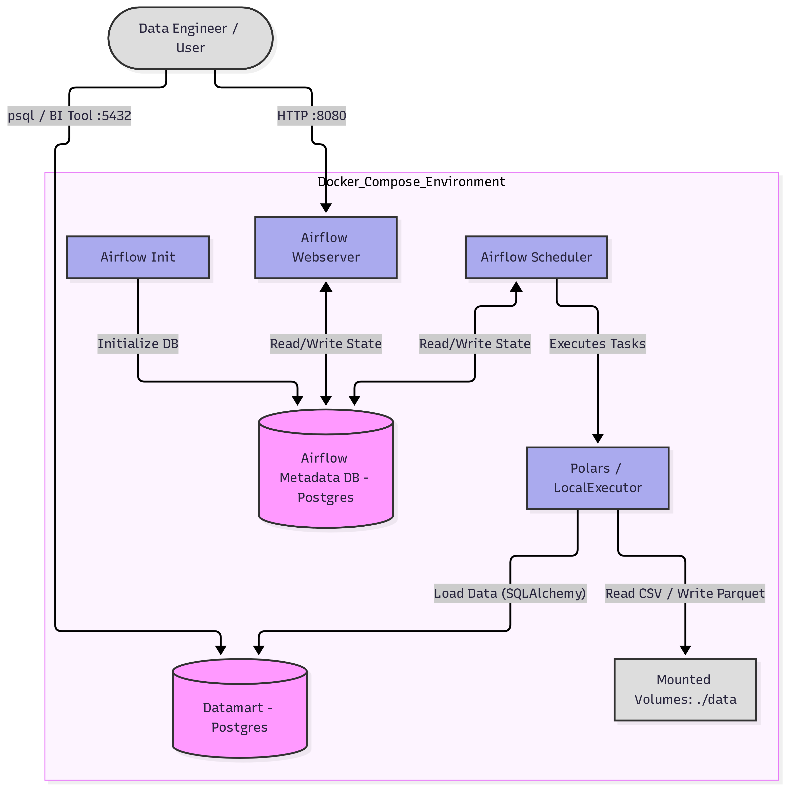

# End-to-End E-Commerce ETL Pipeline (Student Assignment)

Yêu cầu: xây dựng ETL Pipeline hoàn chỉnh dựa trên dữ liệu E-commerce (`data/raw`). 
Nhiệm vụ là thiết kế và cài đặt hệ thống trên để tạo ra một luồng dữ liệu chuẩn Medallion Architecture.

Gợi ý: Ngoài tự thiết kế học viên có thể tham khảo một khung kiến trúc mẫu bên dưới nhưng cần hoàn thành các đoạn code còn thiếu (được đánh dấu bằng `# TODO`) để cài đặt các phép xử lý trong ETL pipeline.

## Mục tiêu học tập

1. Áp dụng kiến trúc **Medallion (Bronze, Silver, Gold)**.
2. Xây dựng DAG bằng **Apache Airflow** để điều phối toàn bộ workflow.
3. Sử dụng **Polars** để xử lý dữ liệu tốc độ cao thay vì Pandas.
4. Áp dụng các quy tắc **Data Contract** (VD: `price > 0`, kiểm tra null) và quản lý dữ liệu lỗi qua **DLQ (Dead Letter Queue)**.
5. Thiết kế Data Mart theo **Star Schema** trên **PostgreSQL** và xử lý kỹ thuật **UPSERT**.

## Kiến trúc mẫu (Infrastructure Architecture)

Hệ thống được thiết lập dựa trên Docker Compose với sơ đồ hạ tầng như sau:



- **Airflow Environment**:
  - **Webserver (Port 8080) & Scheduler**: Hai thành phần chính quản lý và thực thi DAG. Chúng hoạt động độc lập và đồng bộ trạng thái duy nhất qua Metadata DB.
  - **Metadata DB (Postgres)**: Database trung tâm chứa siêu dữ liệu của Airflow.
  - **Airflow Init**: Container chạy một lần. Nó sử dụng kết nối thẳng tới Metadata DB (qua SQLAlchemy) để tạo bảng và tài khoản Admin. Sau khi xong việc, container này tự động tắt (exit).
- **Datamart DB**: Database PostgreSQL chạy ở Port 5432, đóng vai trò Data Mart lưu trữ kết quả đầu ra (Gold layer).
- **Local Filesystem (`./data`)**: Volume được mount vào Airflow chứa dữ liệu Raw, và thư mục lưu trữ Bronze, Silver, DLQ (dưới định dạng Parquet).

## Cấu trúc thư mục hiện tại

```text
lab-student-assignment/
├── dags/
│   └── ecommerce_etl_dag.py    <-- TODO: Khai báo và kết nối các task
├── data/
│   └── raw/                    <-- Chứa dữ liệu CSV nguồn
├── img/
├── sql/
│   └── init_db.sql             <-- TODO: Viết lệnh DDL tạo các bảng cho Gold schema
├── src/
│   ├── extract.py              <-- TODO: Viết logic chuyển CSV sang Parquet (Bronze)
│   ├── transform.py            <-- TODO: Viết logic làm sạch, join, data quality (Silver)
│   └── load.py                 <-- TODO: Viết logic đọc từ Silver đẩy vào Postgres bằng Upsert (Gold)
├── docker-compose.yml
├── Dockerfile
└── requirements.txt
```

## Các bước thực hiện (Hướng dẫn làm bài)

### Bước 1: Khởi tạo và thiết lập CSDL

1. Mở file `sql/init_db.sql`.
2. Dựa vào các TODO comments, hãy hoàn thành các lệnh `CREATE TABLE` để thiết lập Star Schema (gồm các Dimension tables: products, sellers và Fact tables: order_items, order_payments, order_reviews).
3. Thêm các index cần thiết để tăng tốc độ truy vấn.

### Bước 2: Viết logic Extract (Bronze Layer)

1. Mở file `src/extract.py`.
2. Điền code vào vị trí `TODO` để sử dụng `polars` đọc các file CSV. Nên sử dụng tham số `ignore_errors=True` khi đọc dữ liệu không hoàn hảo.
3. Lưu dữ liệu dưới định dạng Parquet vào `BRONZE_DIR` (`/opt/airflow/data/bronze`).

### Bước 3: Viết logic Transform (Silver Layer & Data Contract)

1. Mở file `src/transform.py`.
2. Đọc các file Parquet từ Bronze layer.
3. Thực hiện làm sạch dữ liệu:
   - Loại bỏ trùng lặp (duplicate).
   - Xử lý giá trị rỗng (null values).
   - Join các bảng với nhau (như hợp nhất thông tin địa lý).
4. **Data Contract**:
   - Khi xử lý `fct_order_items`, đảm bảo `price > 0` và `freight_value >= 0`.
   - Những dòng không thỏa mãn điều kiện, thay vì bỏ đi, hãy lưu vào thư mục `DLQ_DIR` (`/opt/airflow/data/dlq`).
5. **Data Quality**: 
   - Hoàn thiện hàm `check_quality` (mô phỏng Great Expectations). Kiểm tra tính nguyên vẹn (ví dụ `customer_id` không được null, số lượng dòng `> 0`). Nếu fail thì gán `passed = False`.

### Bước 4: Viết logic Load (Gold Layer)

1. Mở file `src/load.py`.
2. Hoàn thiện hàm `upsert_table`: Dùng `to_sql` để đẩy DataFrame vào bảng tạm (temp table) trên PostgreSQL. Sau đó, viết câu lệnh `INSERT ... ON CONFLICT (...) DO UPDATE` để đưa dữ liệu từ bảng tạm vào bảng chính thức.
3. Đọc dữ liệu từ Silver layer và gọi `upsert_table` để nạp vào cơ sở dữ liệu `datamart`.
4. *Lưu ý*: Đối với các bảng Fact có chứa thời gian, hãy ép kiểu (cast) về `datetime64[ns]` trước khi đưa vào CSDL.

### Bước 5: Hoàn thiện Airflow DAG

1. Mở file `dags/ecommerce_etl_dag.py`.
2. Khai báo các Operator (`EmptyOperator`, `PythonOperator`, `BranchPythonOperator`) tương ứng với từng task.
3. Liên kết các task lại với nhau theo đồ thị dependencies (sử dụng toán tử `>>`):
   - Workflow thành công: `start -> extract -> transform -> check_quality -> load -> execution_report -> end`
   - Workflow thất bại Data Quality: `check_quality -> alert_quality -> end`

## Hướng dẫn chạy và kiểm tra (Testing)

Sau khi điền đủ code, làm theo các bước sau để chạy Pipeline:

**1. Cấp quyền cho thư mục dữ liệu:**

```bash
chmod -R 777 data
```

**2. Khởi tạo Airflow metadata và tài khoản mặc định (admin/admin):**

```bash
docker-compose up airflow-init
```

**3. Bật các service:**

```bash
docker-compose up -d
```

**4. Chạy DAG:**

- Mở trình duyệt và truy cập `http://localhost:8080`.
- Đăng nhập bằng `admin` / `admin`.
- Tìm DAG `ecommerce_end_to_end_etl`, unpause và bấm **Trigger DAG**.
- Theo dõi các task. Bấm vào Log của task để xem báo cáo (hoặc xem quá trình Data Quality Check).

**5. Kiểm tra kết quả trong Data Mart:**

```bash
# Kết nối vào Postgres container
docker-compose exec datamart psql -U admin -d ecommerce

# Chạy một vài câu SQL để kiểm tra
ecommerce=# SELECT COUNT(*) FROM gold.dim_customers;
ecommerce=# SELECT * FROM gold.fct_order_items LIMIT 5;
```
